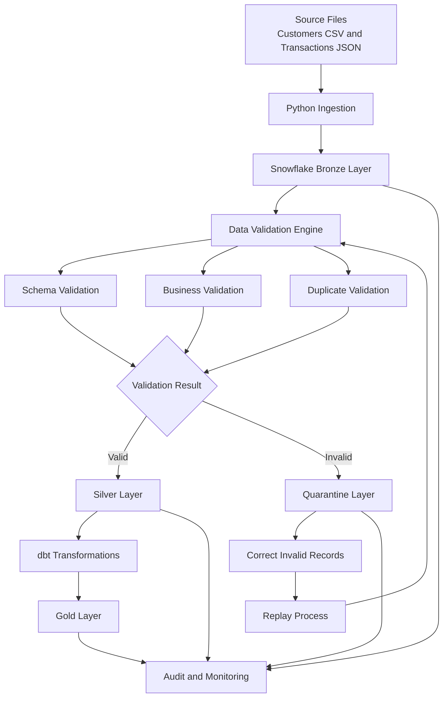

# Architecture – Smart Data Quality & Quarantine Pipeline

## 1. Project Overview

I built this project to validate transaction data before it reaches the reporting layer. The pipeline identifies invalid records, separates them from valid records, stores rejected records for investigation, and supports replay after correcting the underlying data.

The solution uses Python, Snowflake, PySpark-related data processing components, SQL and dbt.

The architecture follows a layered data processing approach:

- **Bronze:** Stores incoming raw data.
- **Silver:** Stores validated transaction records.
- **Quarantine:** Stores rejected records with validation details.
- **Gold:** Contains transformed data for reporting and analytics.
- **Audit:** Tracks pipeline execution and replay activity.

## 2. High-Level Architecture

## 3. Data Sources and Ingestion

The pipeline accepts transaction data from structured source files.

Current sample inputs include:

- `customers.csv` – customer master information.
- `transactions.json` – transaction records.

For larger-volume testing, I also generated sample datasets containing 1,000 customers and 100,000 transactions.

The ingestion process loads the incoming records into Snowflake's Bronze layer. The Bronze layer preserves the raw transaction data so that downstream processing can work from a consistent source.

**Main components:**

- `src/ingestion/bronze_ingestion.py`
- `scripts/generate_large_dataset.py`
- `scripts/bulk_load_to_snowflake.py`

## 4. Bronze Layer

The Bronze layer is the initial storage layer for incoming data.

Main tables:

| Table | Purpose |
|---|---|
| `BRONZE.CUSTOMERS` | Stores customer master records |
| `BRONZE.RAW_TRANSACTIONS` | Stores incoming transaction records |

Raw records are retained before validation and transformation. This makes it possible to trace processed records back to their original source.

## 5. Data Validation Engine

The validation engine checks transaction records before they enter the Silver layer.

I separated the validation logic into individual modules so that each type of check can be understood, tested and maintained independently.

### 5.1 Schema Validation

Checks whether required transaction fields are present and whether records have the expected structure.

Example checks:

- Required transaction ID.
- Customer ID availability.
- Transaction amount availability.
- Transaction type availability.
- Transaction timestamp availability.

File: `src/validation/schema_validation.py`

### 5.2 Business Validation

Checks whether transaction records satisfy the business conditions used by the pipeline.

Examples:

- Customer must exist in the customer master table.
- Transaction amount must be positive.
- Transaction type must be CREDIT or DEBIT.

File: `src/validation/business_validation.py`

### 5.3 Duplicate Validation

Identifies transaction records with duplicate event or transaction identifiers.

This prevents duplicate records from being treated as independent valid transactions.

File: `src/validation/duplicate_validation.py`

## 6. Silver Layer and Quarantine

After validation, records are separated according to their validation results.

### Valid records – Silver

Valid records are stored in:

`SILVER.VALID_TRANSACTIONS`

This layer contains transaction records that have passed the implemented validation checks.

### Invalid records – Quarantine

Rejected records are stored in:

`SILVER.QUARANTINE_RECORDS`

The quarantine process preserves rejected records and their associated validation information so they can be investigated and corrected.

This separation prevents rejected records from entering the downstream reporting flow.

**Main components:**

- `src/transformation/silver_transformation.py`
- `src/transformation/run_silver.py`
- `src/transformation/snowflake_publisher.py`
- `src/transformation/bulk_silver_pipeline.py`

## 7. Quarantine Replay and Recovery

Quarantine is not just a place to store invalid records. The pipeline also includes a replay process for records that have been corrected.

The replay workflow is:

1. Identify a quarantined record.
2. Correct the underlying data.
3. Submit the corrected record through the replay process.
4. Run the validation checks again.
5. Publish the record to Silver if it passes validation.
6. Record the replay outcome.

Replay execution is tracked using:

`AUDIT.REPLAY_HISTORY`

The replay process helps recover corrected records without requiring the entire source dataset to be processed again.

**Main components:**

- `src/quarantine/replay.py`
- `src/quarantine/replay_runner.py`

## 8. Gold Layer and Analytics

The Gold layer contains transformed data intended for reporting and analytical queries.

Main tables:

| Table | Purpose |
|---|---|
| `GOLD.FACT_TRANSACTIONS` | Stores transaction-level analytical data |
| `GOLD.DAILY_TRANSACTION_SUMMARY` | Stores daily transaction aggregates |

The Gold layer is built from validated Silver data.

Example reporting metrics include:

- Total transaction count.
- Total transaction amount.
- Total credit amount.
- Total debit amount.
- Daily transaction summaries.

The SQL transformations are maintained under `sql/gold/`.

## 9. dbt Transformation Layer

I use dbt to organize downstream SQL transformations and data quality tests.

The dbt project includes:

- Staging models.
- Fact and dimension transformations.
- Daily transaction summary model.
- Schema and data tests.

The dbt models are maintained under:

`dbt_project/models/`

This separates transformation logic from ingestion and validation code, making downstream models easier to maintain.

## 10. Audit and Monitoring

The audit layer keeps track of pipeline execution and processing results.

Main audit tables:

- `AUDIT.PIPELINE_RUNS`
- `AUDIT.REPLAY_HISTORY`

The monitoring components check processing status and compare record counts across the pipeline.

Important checks include:

- Bronze, Silver and Quarantine record counts.
- Reconciliation between source and processed records.
- Silver and Gold record counts.
- Duplicate records.
- Pipeline execution status.
- Audit record consistency.

**Main components:**

- `src/monitoring/pipeline_recovery.py`
- `src/monitoring/pipeline_health_monitor.py`

## 11. Large-Volume Processing

To evaluate the pipeline with a larger dataset, I generated 100,000 transaction records and loaded them into Snowflake.

The generated dataset includes deliberately introduced data quality issues, such as:

- Unknown customer references.
- Negative transaction amounts.
- Missing customer information.
- Duplicate transaction records.

The bulk processing workflow uses Snowflake SQL operations to classify records and publish the results into the appropriate layers.

Supporting files:

- `scripts/generate_large_dataset.py`
- `scripts/bulk_load_to_snowflake.py`
- `scripts/benchmark_100k_validation.py`
- `src/transformation/bulk_silver_pipeline.py`

## 12. Technology Stack

| Technology | Usage |
|---|---|
| Python | Pipeline implementation and orchestration |
| PySpark | Distributed data processing components |
| Snowflake | Cloud data storage and SQL processing |
| Snowflake SQL | Data validation, loading and transformations |
| dbt | SQL modelling and data testing |
| Pandas | Data handling and dataset preparation |
| Git and GitHub | Version control and project hosting |

## 13. End-to-End Execution Flow

The overall execution sequence is:

1. Prepare the source customer and transaction files.
2. Load source records into Snowflake Bronze tables.
3. Execute schema validation.
4. Execute business validation.
5. Identify duplicate transaction records.
6. Separate valid and rejected records.
7. Store valid records in Silver.
8. Store rejected records in Quarantine.
9. Correct selected quarantined records and replay them.
10. Build Gold reporting tables.
11. Execute dbt transformations and tests.
12. Run reconciliation, monitoring and recovery checks.

## 14. Design Approach

I kept ingestion, validation, transformation, quarantine, replay and monitoring in separate modules.

This approach makes the project easier to understand and maintain. It also allows individual components to be tested without mixing every operation into a single Python script.

Snowflake handles the persistent data layers and large-volume SQL processing, while Python coordinates the pipeline components and recovery workflow.

The overall design focuses on data correctness, traceability, controlled recovery and reliable downstream reporting.